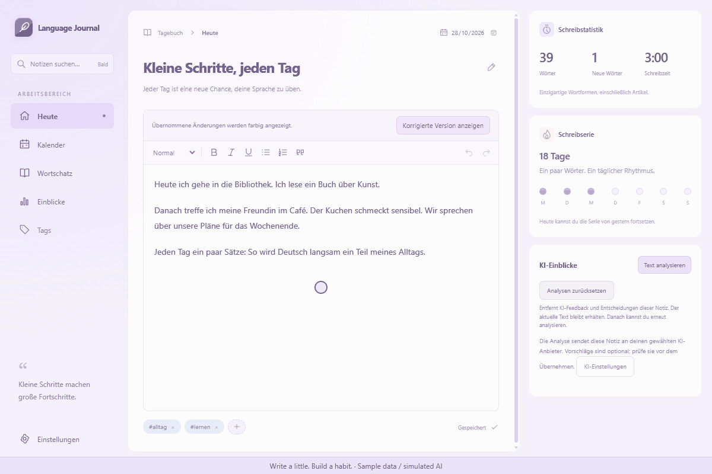
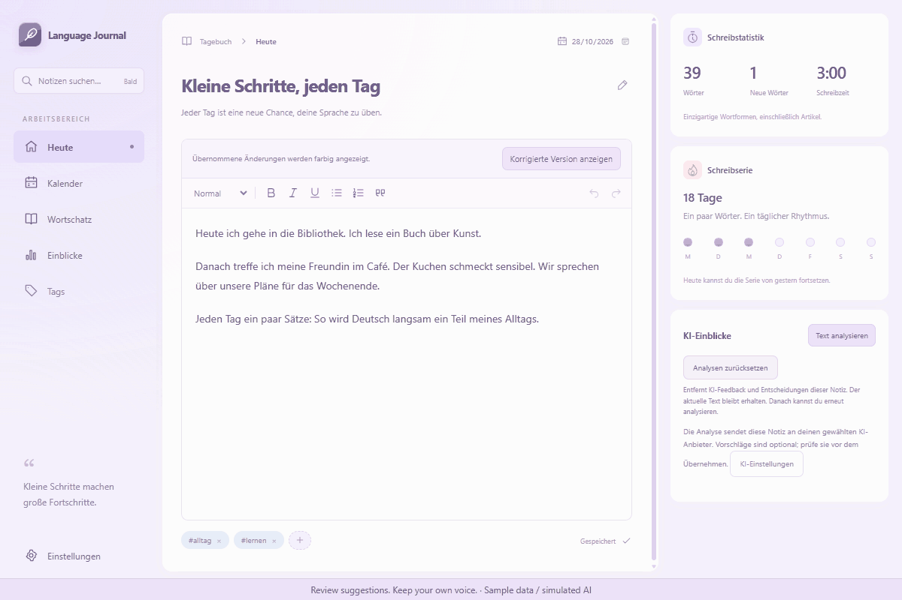
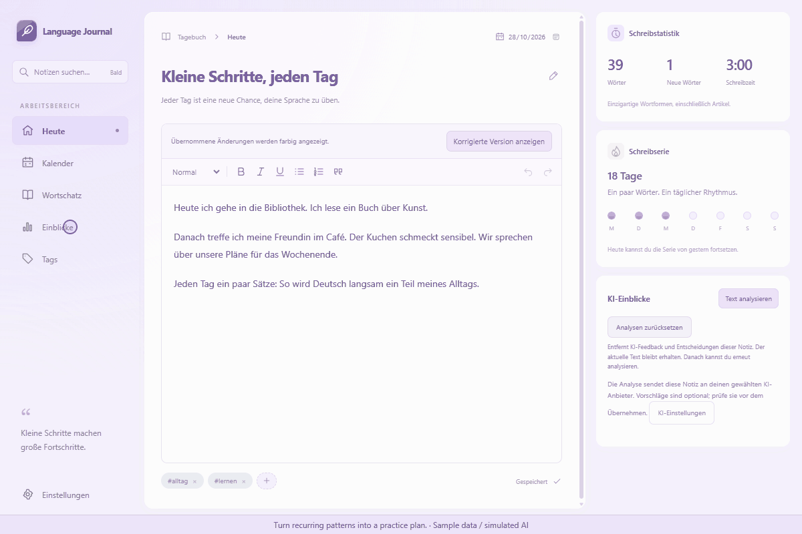
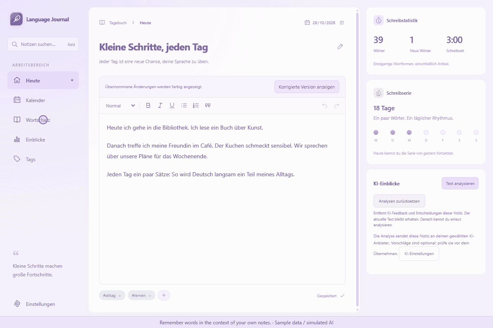

# Language Journal

A Windows writing journal for learning **German and English**. Write daily notes, grow your vocabulary, and turn feedback into practice.

- **Write:** rich-text notes with local autosave, tags, a calendar, and writing streaks.
- **Review:** optional AI grammar, word-choice, and naturalness feedback; accept or dismiss corrections.
- **Reflect:** weekly/monthly insights and deep AI reviews with patterns and practice suggestions.
- **Learn:** vocabulary statistics and Anki-style cards with definitions, examples from your notes, and spaced repetition.

## Demos

Four 10-second recordings of the real interface using sample notes and simulated AI responses. Timing is edited; no personal data or API keys are shown.

**Writing, autosave & calendar**



**AI corrections**



**Deep analysis**



**Anki-style learning**



## Run & use

Requires Windows, Node.js/npm, Rust, Microsoft C++ Build Tools, WebView2, and Python 3.12 for vocabulary analysis.

```powershell
npm.cmd install
powershell.exe -NoProfile -ExecutionPolicy Bypass -File scripts/setup-nlp.ps1
npm.cmd run tauri dev
```

Write in **Today**; notes save automatically. Choose German or English in **Settings**, and optionally add an OpenAI/Gemini API key. Use **Analyze text**, **Insights**, or **Vocabulary → My learning set** to review and practise.

Notes live at `D:\GermanNotesData\notes.db`; the analyzer uses `D:\Dev\deutsch-journal-nlp`. These paths currently require a D: drive. AI sends text only when requested; keys use Windows Credential Manager. [Detailed setup and behavior](docs/guide.md).

**Stack:** Tauri 2 · Rust · React 19 · TypeScript · Vite · Tiptap/ProseMirror · SQLite/rusqlite · Python/spaCy · OpenAI/Gemini APIs.
